<a href="https://kelvinlikollari.vercel.app"></a>

<p align="center">
  <a href="https://kelvinlikollari.vercel.app"></a>
  <a href="https://www.linkedin.com/in/kelvin-likollari"></a>
  <a href="mailto:kelvilikol13@gmail.com"></a>
  <a href="https://kelvinlikollari.vercel.app/thesis.html"></a>
</p>

Backend developer with an M.Sc. in Informatics from USI Lugano. I've shipped Python, Django and PostgreSQL to production, wrote my thesis on LLM workflows that keep a person in control, and now work on Avaloq core banking software at HCLTech.


### Now

```yaml
role:      Software Developer at HCLTech, since 10/2026
platform:  Avaloq core banking
based_in:  Lugano, Switzerland
degree:    M.Sc. Informatics, USI, 06/2026
learning:  AI agents, LLM application development, human-in-the-loop design
speaks:    Greek, Albanian, English, Italian, a little Spanish
```

### Selected work

<table>
  <tr>
    <td width="50%" valign="top">
      <h4><a href="https://github.com/likolk/MasterThesis">Human-supervised LLM validation</a></h4>
      <p>Master thesis. A five-level data sensitivity baseline for small companies, and a platform where an LLM suggests, a policy checks and a person decides. Security experts rated it 4.1 / 5.</p>
      <p><code>Python</code> <code>Flask</code> <code>PostgreSQL</code> <code>Gemini API</code></p>
      <p><a href="https://kelvinlikollari.vercel.app/thesis.html">Case study and poster</a></p>
    </td>
    <td width="50%" valign="top">
      <h4><a href="https://github.com/likolk/stack_underflow">Stack Underflow</a></h4>
      <p>Real-time Q&amp;A platform built by a team of seven. I led the team and owned the backend, the APIs and the WebSocket layer.</p>
      <p><code>Node.js</code> <code>Express</code> <code>Socket.io</code> <code>MongoDB</code> <code>Docker</code></p>
    </td>
  </tr>
  <tr>
    <td width="50%" valign="top">
      <h4><a href="https://github.com/likolk/DSProject">Decentralised shareholder voting</a></h4>
      <p>Share-weighted voting on Ethereum. Shares are tokenised one to one and locked while a vote is open, with configurable quorums.</p>
      <p><code>Solidity</code> <code>Hardhat</code> <code>Vue</code> <code>Node.js</code></p>
    </td>
    <td width="50%" valign="top">
      <h4><a href="https://github.com/likolk/RemoveBackground">RemoveBackground</a></h4>
      <p>Upload an image, get it back with the background removed. A small Flask app, packaged with Docker.</p>
      <p><code>Python</code> <code>Flask</code> <code>rembg</code> <code>Docker</code></p>
    </td>
  </tr>
</table>

<details>
<summary><b>More projects</b></summary>
<br>

| Project | What it is |
| --- | --- |
| [Sudoku SAT solver](https://github.com/likolk/Sudoku-Sat-Solver) | Sudoku encoded as a SAT problem and solved with Z3, with a pygame interface |
| [Travelling Salesman Problem](https://github.com/likolk/Travelling-Salesman-Problem-TSP) | Nearest neighbour, 2-opt, 3-opt and iterated local search in C++ |
| [camelCase vs kebab-case](https://github.com/likolk/camelCase-vs-kebab-case) | A controlled readability experiment, run as a Django web app |
| [Battleship](https://github.com/likolk/Battleship-Game) | Battleship in Java with graphical and text interfaces |
| [Expression Simplifier](https://github.com/likolk/Expression-Simplifier) | Parses a maths expression and draws its tree, in Java |
| [Bachelor project](https://github.com/likolk/bachelor-project) | An empathy game that teaches children about diversity and inclusion |

</details>

### Stack

<p>
  <br>
  
</p>

Also: LLM APIs (Claude, OpenAI, Gemini), RAG with pgvector, REST API design, Avaloq.

### Activity

<p>
  
  
</p>


<p align="center">Hiring, a project idea, or a question about something I built: <a href="mailto:kelvilikol13@gmail.com">email</a> is the fastest way to reach me.</p>
